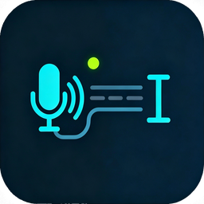

  

<h1 align="center">BeepType</h1>

手机说话，电脑落字

  
  
  
  
  

---

**BeepType 把手机上的两种内容送到电脑的光标处：语音转成的文字，和图片。**

手机既是麦克风也是识别端：按住手机输入法的语音键说话，松开后文字通过局域网直接落进电脑上你正在用的那个输入框——用的就是你手机输入法的词库、方言与表达习惯。图片同理：在手机上选图，电脑剪贴板里就是这张图。**任何能打字的地方都能用**：聊天框、浏览器、文档、编辑器、终端。

## 怎么工作

- **内容在手机上产生**：语音由你手机输入法完成识别，图片由你从相册选择——都不经过我们的服务器
- **局域网直连**：两端在同一局域网内通过 TCP 直连，电脑端收到后写入系统剪贴板，再按你的设置自动粘贴、自动发送
- **文字与图片可以一起发**：图片先贴、文字随后，落在同一条消息里

## 什么时候用得上

1. **长文本口述** — 消息、邮件、文档、代码注释：想说的话很长，敲键盘太麻烦
2. **在电脑上聊天 / 回消息** — 一边干活一边回，不必切输入法
3. **图片送到电脑** — 手机上的任意图片（截图、照片、下载的图），要它出现在电脑上

## 功能

**核心**

- **语音转文字到光标处** — 松开语音键即落字；可自动粘贴、可自动回车；按住语音键期间一个字都不会发，松手后整段一次发出
- **图片到电脑** — 手机选图（可多选），电脑剪贴板里就是这张图；可与文字一起发送，先选后发、可逐张删、可继续加

**体验**

- **配对与绑定** — 扫码即连；常用设备免配重连；临时连接在窗口期内可自动续连；电脑被别的手机占用时，常用设备点「连接」即可接管
- **零账号 · 零云端 · 内容不落盘** — 局域网直连，不经任何服务器；内容只在内存与剪贴板里流转
- **跨平台** — PC 端 Linux（X11）/ Windows / macOS；手机端 Android

## 快速开始

前提：**手机和电脑在同一个局域网**（同一个 Wi-Fi，或电脑连在手机热点上）。

| 平台 | 下载 |
|------|------|
| Linux | `.deb` / `.AppImage` |
| Windows | `.msi` |
| macOS | `.dmg` |
| Android | `.apk` |

前往 [Releases](https://github.com/jihonghe/beeptype/releases) 下载；从源码构建与开发环境见 [CONTRIBUTING.md](CONTRIBUTING.md)。

**三步用起来**

1. 电脑上启动 BeepType，托盘出现图标，点开主窗口
2. 手机上打开 BeepType，点顶部扫码按钮，扫电脑上的二维码（想长期使用就勾选「记住这台手机」）
3. 在手机上按住输入法的语音键说话，松开——文字出现在电脑光标处；图片点输入框下方的「添加图片」选图，与文字一起发送

## 平台支持

| 平台 | 最低版本 | 自动粘贴 | 自动发送 | 备注 |
|---|---|---|---|---|
| Linux X11 | — | ✅ | ✅ | |
| Linux Wayland | — | ❌ | ❌ | 系统禁止后台进程注入按键，退化为手动 Ctrl+V（文字与图片都能用） |
| Windows | 10 | ✅ | ✅ | |
| macOS | 12 | ✅ | ✅ | |
| Android | 8.0 | — | — | 手机端 |
| iOS | — | — | — | 未支持，见「即将到来」 |

## 已知限制

- **两端必须在同一局域网**：不做云端中继，跨网络（手机用流量）用不了
- **Wayland 会话**：不支持自动粘贴与自动发送，只能手动 Ctrl+V
- **图片**：只有**支持粘贴图片**的输入框能自动贴出来；需要「上传附件」的输入框不会响应（图片仍在电脑剪贴板里）
- **语音识别由手机输入法提供**：遇到"边说边逐段提交"的输入法（如讯飞、搜狗），我们同样只在松手后发一次

## 🚧 即将到来

- [ ] **手机端输入控制台** — 历史记录、编辑后重发、失败不丢原文
- [ ] **自定义键位** — 粘贴键与发送键可自选（普通应用与终端各一组；终端内默认不自动发送）
- [ ] **iOS 适配** — 原生通道代码已就绪，待真机验证与分发
- [ ] **Wayland 会话的自动粘贴**（探路）
- [x] 松手才发（v0.7.1）、图片传输（v0.8.0）、Release 自动构建

> 更详细的路线图、竞品地图与明确**不做**的事，见 [`docs/PRODUCT.md`](docs/PRODUCT.md)。

## 安全与隐私

- 配对码与设备凭证都是 32 字节随机串，只存 SHA-256；配对码一次性、5 分钟过期
- 局域网直连，**不经任何外部服务器**
- **内容不落盘**：电脑端只写入系统剪贴板与内存，不留文件
- 不做账号、不做云中继、不做遥测
- 细节与已知边界见 [SECURITY.md](SECURITY.md)

## 🤝 贡献

欢迎 Issue 和 PR！开发环境、测试与发版流程见 [CONTRIBUTING.md](CONTRIBUTING.md)。

## 📄 License

[MIT License](LICENSE)

## 🙏 致谢

- [enigo](https://github.com/pasce/enigo) — Rust 跨平台键盘模拟
- [Flutter](https://flutter.dev) — 手机端
- [Tauri](https://tauri.app) — 桌面端
- **ZCode** — AI 编程助手：本项目的开发全程与它协作完成
- **DeepSeek-V4.1 flash** — 开发所用的模型
